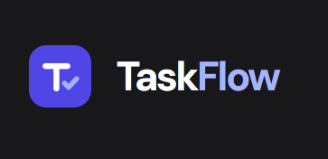
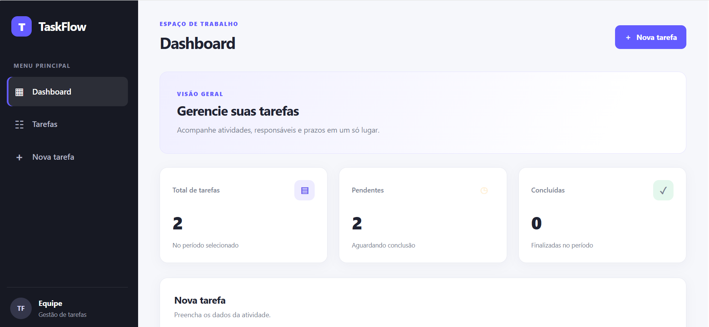
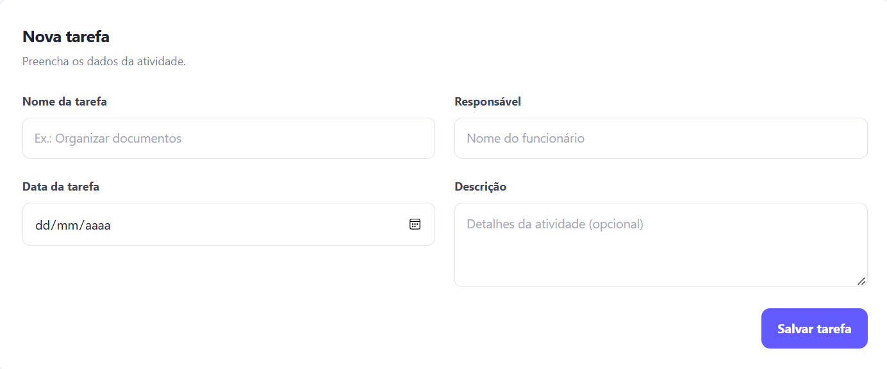
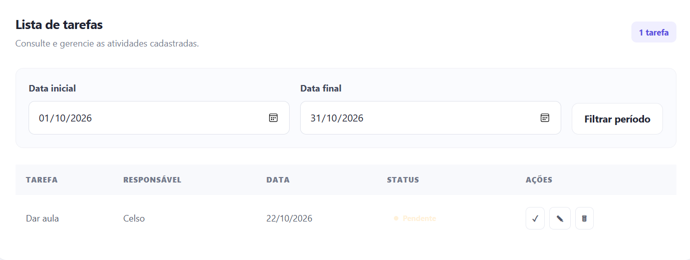

# TaskFlow - Sistema de Gerenciamento de Tarefas
<p align="center">
  
</p>

<p align="center">
  <strong>Uma aplicação web para gerenciamento e acompanhamento de tarefas.</strong>
</p>

<p align="center">
  
  
  
  
  
  
</p>

---

## Índice

- [Sobre o projeto](#sobre-o-projeto)
- [Status do projeto](#status-do-projeto)
- [Funcionalidades](#funcionalidades)
- [Demonstração da aplicação](#demonstração-da-aplicação)
- [Acesso ao projeto](#acesso-ao-projeto)
- [Tecnologias utilizadas](#tecnologias-utilizadas)
- [Arquitetura da aplicação](#arquitetura-da-aplicação)
- [Como executar o projeto](#como-executar-o-projeto)
- [Endpoints da API](#endpoints-da-api)
- [Pessoas contribuidoras](#pessoas-contribuidoras)
- [Pessoa desenvolvedora](#pessoa-desenvolvedora)
- [Licença](#licença)

---

## Sobre o projeto

O **TaskFlow** é uma aplicação de gerenciamento de tarefas desenvolvida para organizar atividades, registrar responsáveis, definir datas e acompanhar o andamento das demandas.

O projeto utiliza uma API REST para intermediar a comunicação entre a interface web e o banco de dados relacional, mantendo a aplicação organizada em componentes com responsabilidades distintas.

A proposta é aplicar conceitos fundamentais do desenvolvimento web, incluindo operações CRUD (*Create, Read, Update and Delete*), comunicação HTTP, persistência de dados e integração entre front-end e back-end.

### Objetivos

- Desenvolver uma aplicação web integrada a uma API REST.
- Implementar operações de criação, consulta, atualização e exclusão de tarefas.
- Persistir informações em um banco de dados relacional.
- Organizar o código em módulos com responsabilidades definidas.
- Praticar conceitos de desenvolvimento back-end e integração com interfaces web.

## Status do projeto

**Em desenvolvimento.**

O projeto possui funcionalidades de gerenciamento de tarefas e integração entre o front-end, a API e o banco de dados. A conclusão da documentação e a evolução das funcionalidades fazem parte do processo de desenvolvimento.

## Funcionalidades

As funcionalidades contempladas pela API incluem:

- [x] Criar uma tarefa.
- [x] Consultar uma tarefa pelo identificador.
- [x] Consultar tarefas por intervalo de datas.
- [x] Atualizar uma tarefa existente.
- [x] Excluir uma tarefa.
- [x] Armazenar tarefas no banco de dados MariaDB.
- [x] Integrar o front-end à API por meio de requisições HTTP.

Cada tarefa possui os seguintes dados:

| Campo | Descrição |
|---|---|
| `id` | Identificador único da tarefa |
| `nome` | Nome da tarefa |
| `descricao` | Descrição complementar |
| `responsavel` | Pessoa responsável pela tarefa |
| `data_tarefa` | Data associada à tarefa |
| `concluido` | Indica se a tarefa foi concluída |

## Demonstração da aplicação

Esta seção deve apresentar capturas reais da interface, permitindo que visitantes compreendam rapidamente a aparência e o funcionamento do TaskFlow.

### Visão geral
<p align="center">
  
</p>

### Cadastro e edição de tarefas

<p align="center">
  
</p>

### Consulta e filtragem
<p align="center">
  
</p>

## Acesso ao projeto

O código-fonte está disponível no GitHub:

**[Acessar o repositório TaskFlow API](https://github.com/ArthurTardin/taskflow-api)**

Para obter uma cópia local, execute:

```bash
git clone https://github.com/ArthurTardin/taskflow-api.git
cd taskflow-api
```

Em seguida, siga as instruções de configuração e execução descritas abaixo.

## Tecnologias utilizadas

### Back-end

| Tecnologia | Finalidade |
|---|---|
| [Node.js](https://nodejs.org/) | Ambiente de execução JavaScript |
| [Express](https://expressjs.com/) | Criação e organização das rotas HTTP |
| [MariaDB](https://mariadb.org/) | Banco de dados relacional |
| [mysql2](https://sidorares.github.io/node-mysql2/) | Comunicação entre a aplicação e o banco de dados |
| [dotenv](https://github.com/motdotla/dotenv) | Carregamento de variáveis de ambiente |
| [CORS](https://github.com/expressjs/cors) | Controle de acesso entre origens |
| [Nodemon](https://nodemon.io/) | Reinicialização automática durante o desenvolvimento |

### Front-end

| Tecnologia | Finalidade |
|---|---|
| HTML5 | Estrutura das páginas |
| CSS3 | Estilização e apresentação visual |
| JavaScript | Comportamento e interatividade |
| Fetch API | Comunicação HTTP com o back-end |
| ES Modules | Organização e reutilização de módulos JavaScript |
| Live Server | Servidor local para desenvolvimento da interface |

## Arquitetura da aplicação

A aplicação é organizada em três partes principais:

```text
┌───────────────────────────────┐
│          Front-end             │
│       HTML, CSS, JavaScript    │
└───────────────┬───────────────┘
                │
                │ Requisições HTTP
                ▼
┌───────────────────────────────┐
│          Back-end              │
│         Node.js + Express      │
│                               │
│  Rotas → Controladores         │
└───────────────┬───────────────┘
                │
                │ Consultas SQL
                ▼
┌───────────────────────────────┐
│           MariaDB              │
│          tarefas_db            │
└───────────────────────────────┘
```

### Estrutura de diretórios

```text
taskflow-api/
├── src/
│   ├── config/
│   │   └── database.js
│   ├── controllers/
│   │   └── tarefaController.js
│   ├── Routes/
│   │   └── tarefaRoutes.js
│   └── app.js
├── frontend/
│   ├── index.html
│   ├── css/
│   │   └── style.css
│   └── js/
│       ├── api.js
│       └── app.js
├── tarefas api/
│   ├── Atualizar tarefa.yml
│   ├── Buscar tarefa.yml
│   ├── Criar tarefa.yml
│   ├── Excluir tarefa.yml
│   ├── Listar tarefas por período.yml
│   └── opencollection.yml
├── docs/
│   └── images/
├── .env.example
├── .gitignore
├── package.json
├── package-lock.json
├── LICENSE
└── README.md
```

## Como executar o projeto

### Pré-requisitos

Antes de começar, instale:

- [Node.js e npm](https://nodejs.org/)
- [MariaDB](https://mariadb.org/) ou um ambiente compatível com MySQL
- [Visual Studio Code](https://code.visualstudio.com/) ou outro editor
- A extensão Live Server, caso queira executar o front-end dessa forma

### 1. Clone o repositório

```bash
git clone https://github.com/ArthurTardin/taskflow-api.git
cd taskflow-api
```

### 2. Instale as dependências

```bash
npm install
```

### 3. Configure o banco de dados

Crie o banco e a tabela no MariaDB:

```sql
CREATE DATABASE tarefas_db;

USE tarefas_db;

CREATE TABLE tarefas (
    id INT AUTO_INCREMENT PRIMARY KEY,
    nome VARCHAR(100) NOT NULL,
    descricao TEXT,
    responsavel VARCHAR(100) NOT NULL,
    data_tarefa DATE NOT NULL,
    concluido BOOLEAN NOT NULL DEFAULT FALSE
);
```

### 4. Configure as variáveis de ambiente

Crie um arquivo `.env` na raiz do projeto. Use como referência:

```env
PORT=3000
DB_HOST=localhost
DB_PORT=3306
DB_USER=root
DB_PASSWORD=sua_senha_aqui
DB_NAME=tarefas_db
```

Substitua os valores pelos dados do seu ambiente. Não compartilhe senhas reais e não envie o arquivo `.env` ao GitHub.

> Os nomes das variáveis devem corresponder aos que são efetivamente utilizados em `src/config/database.js` e `src/app.js`.

### 5. Inicie o back-end

Para executar em modo de desenvolvimento, se o script `dev` estiver configurado no `package.json`:

```bash
npm run dev
```

Alternativamente, se o script `start` estiver configurado:

```bash
npm start
```

O servidor deverá iniciar na porta definida na configuração, normalmente `3000`.

### 6. Inicie o front-end

Abra a pasta `frontend` no editor e execute o arquivo `index.html` com a extensão Live Server.

Se o servidor estiver na porta `3000`, a API deverá estar acessível em:

```text
http://localhost:3000/api
```

A interface e a API precisam estar executando simultaneamente para que as funcionalidades integradas funcionem.

## Endpoints da API

A API disponibiliza operações para gerenciar tarefas.

| Método | Endpoint | Descrição |
|---|---|---|
| `POST` | `/api/tarefas` | Cria uma tarefa |
| `GET` | `/api/tarefas/:id` | Consulta uma tarefa pelo ID |
| `GET` | `/api/tarefas/periodo?dataInicio=AAAA-MM-DD&dataFim=AAAA-MM-DD` | Consulta tarefas por intervalo de datas |
| `PUT` | `/api/tarefas/:id` | Atualiza uma tarefa |
| `DELETE` | `/api/tarefas/:id` | Exclui uma tarefa |

### Exemplo de criação de tarefa

Requisição:

```http
POST /api/tarefas
Content-Type: application/json
```

Corpo JSON:

```json
{
  "nome": "Estudar Node.js",
  "descricao": "Revisar conceitos de APIs REST",
  "responsavel": "Arthur Tardin",
  "data_tarefa": "2026-10-30",
  "concluido": false
}
```

### Exemplo de consulta por período

```http
GET /api/tarefas/periodo?dataInicio=2026-10-01&dataFim=2026-10-31
```

Os exemplos ilustram o formato esperado das requisições. O comportamento e a validação de cada endpoint dependem da implementação atual dos controladores.

## Pessoas contribuidoras

Contribuições são bem-vindas para aprimorar a organização, a qualidade e as funcionalidades do projeto.

Para contribuir:

1. Faça um fork do repositório.
2. Crie uma branch para sua alteração.
3. Implemente a melhoria ou correção.
4. Registre as mudanças em um commit descritivo.
5. Abra um Pull Request explicando a contribuição.

Antes de enviar alterações, verifique se elas preservam o funcionamento da aplicação e se a documentação correspondente foi atualizada.

## Pessoa desenvolvedora

**Arthur Tardin**

Desenvolvedor do TaskFlow, projeto voltado à aplicação prática de conceitos de desenvolvimento web, criação de APIs REST e integração com banco de dados relacional.

- GitHub: [@ArthurTardin](https://github.com/ArthurTardin)
- Repositório do projeto: [taskflow-api](https://github.com/ArthurTardin/taskflow-api)

## Licença

Este projeto está distribuído sob a licença **MIT**, desde que o arquivo `LICENSE` correspondente esteja presente no repositório.

A licença MIT permite o uso, a cópia, a modificação, a distribuição e a sublicença do software, respeitadas suas condições, incluindo a preservação do aviso de copyright e da licença.

Consulte o arquivo [`LICENSE`](LICENSE) para conhecer os termos completos.

---

<p align="center">
  Desenvolvido por <a href="https://github.com/ArthurTardin">Arthur Tardin</a>.
</p>
